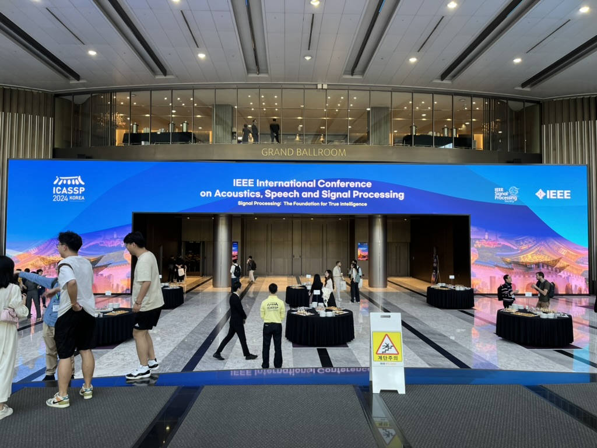
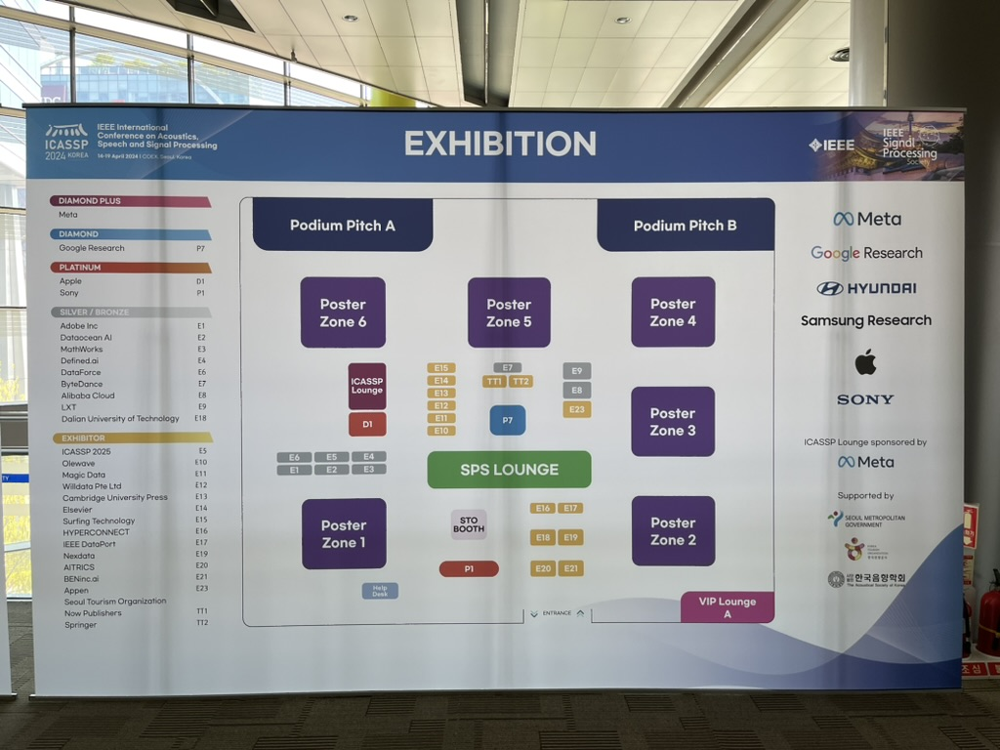
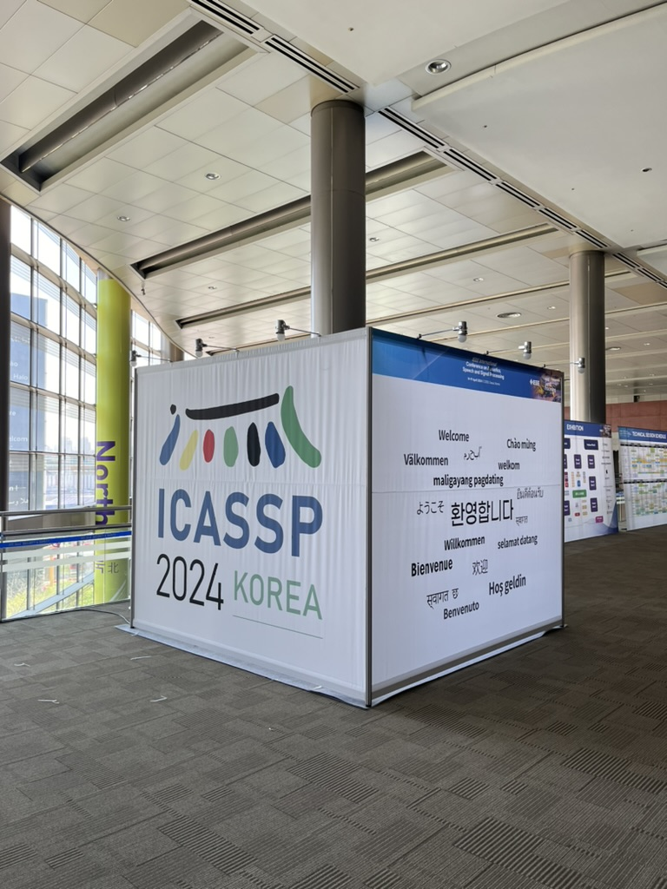
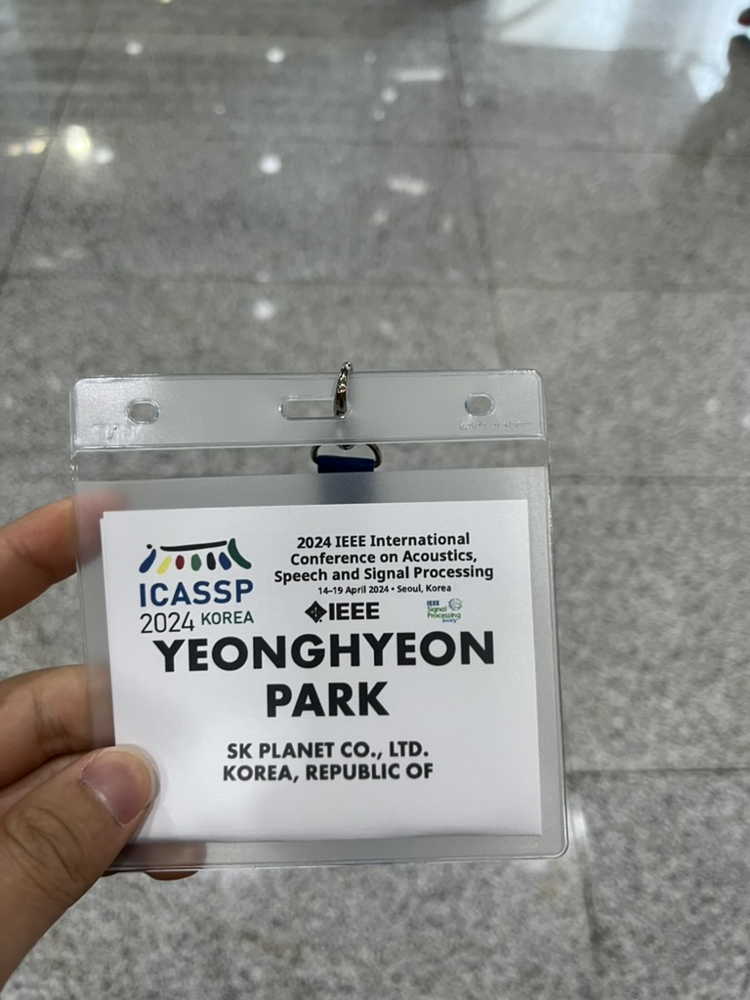
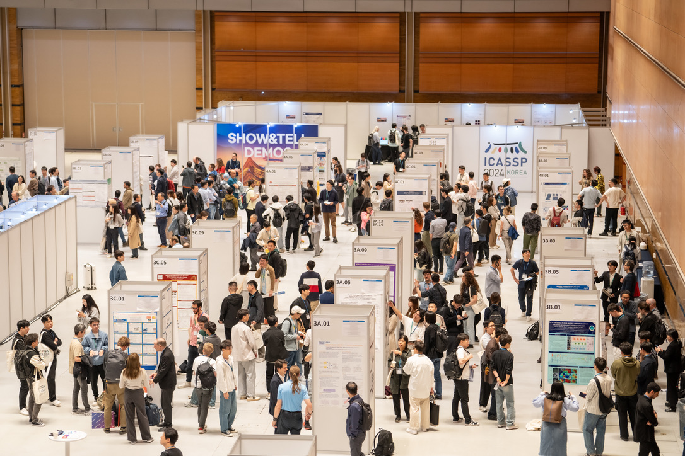
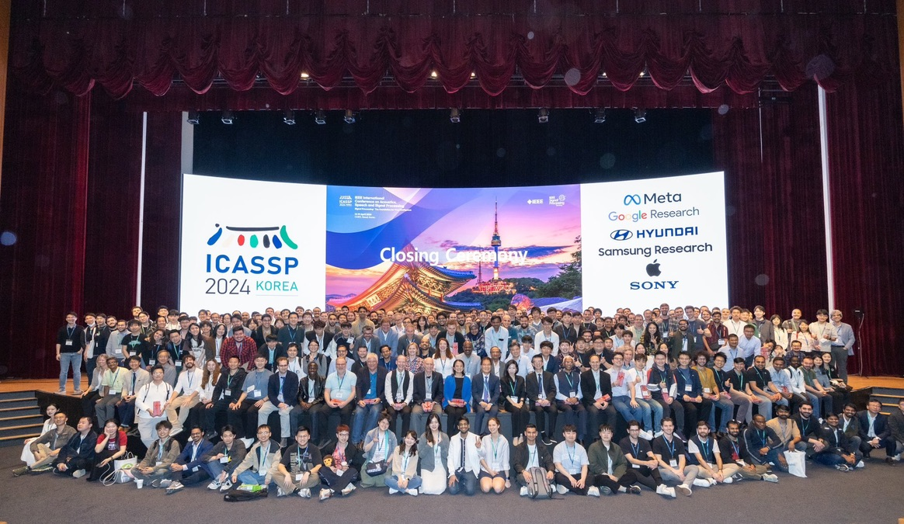
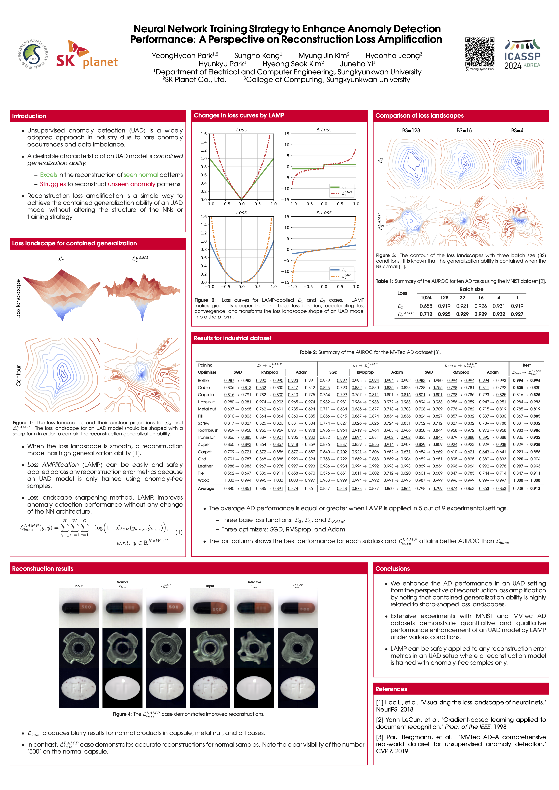

<figure>
	

		
		
	

	<figcaption>The ICASSP 2024 conference hall and exhibition floor plan.</figcaption>
</figure>
 

<figure>
	

		
		
	

	<figcaption>The conference welcome display and my name badge.</figcaption>
</figure>
 

<figure>
	
	<figcaption>Poster session (from X, @ieeeICASSP)</figcaption>
</figure>
 

<figure>
	
	<figcaption>Closing ceremony (from X, @ieeeICASSP)</figcaption>
</figure>
 

<figure>
	 
	<figcaption>My research poster at ICASSP 2024 <a class="btn" href="https://ieeexplore.ieee.org/document/10446942">paper</a><a class="btn" href="https://sigport.org/documents/neural-network-training-strategy-enhance-anomaly-detection-performance-perspective">poster</a></figcaption>
</figure>
 
