<ul class="cards">
  <li class="card"><a href="https://openaccess.thecvf.com/content/CVPR2025W/VAND/html/Park_Feature_Attenuation_of_Defective_Representation_Can_Resolve_Incomplete_Masking_on_CVPRW_2025_paper.html">
    
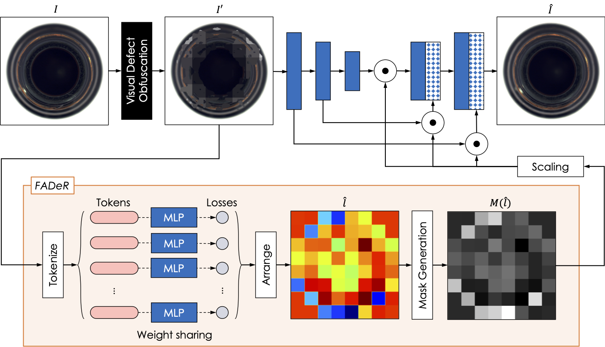

    
FADeR

Industrial anomaly detection · CVPRW 2025
</a></li>

  <li class="card"><a href="https://arxiv.org/abs/2411.07546v2">
    
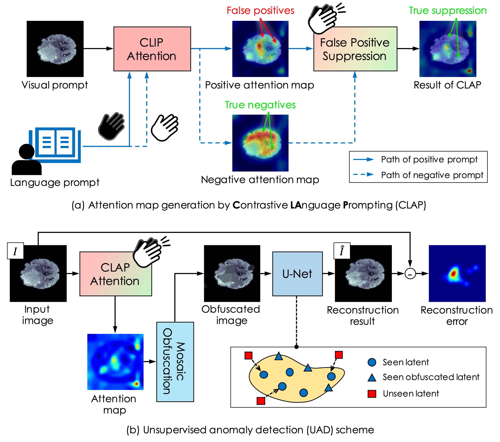

    
CLAP

Medical anomaly detection with vision-language models · ISBI 2025
</a></li>

  <li class="card"><a href="https://www.nature.com/articles/s41598-024-69698-5">
    
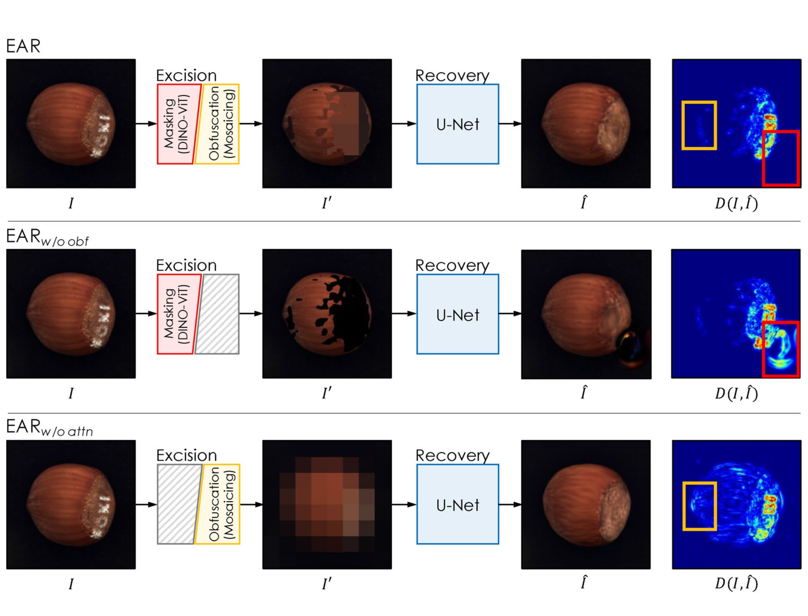

    
EAR

Industrial anomaly detection · Scientific Reports 2024
</a></li>

  <li class="card"><a href="https://arxiv.org/abs/2308.14595">
    
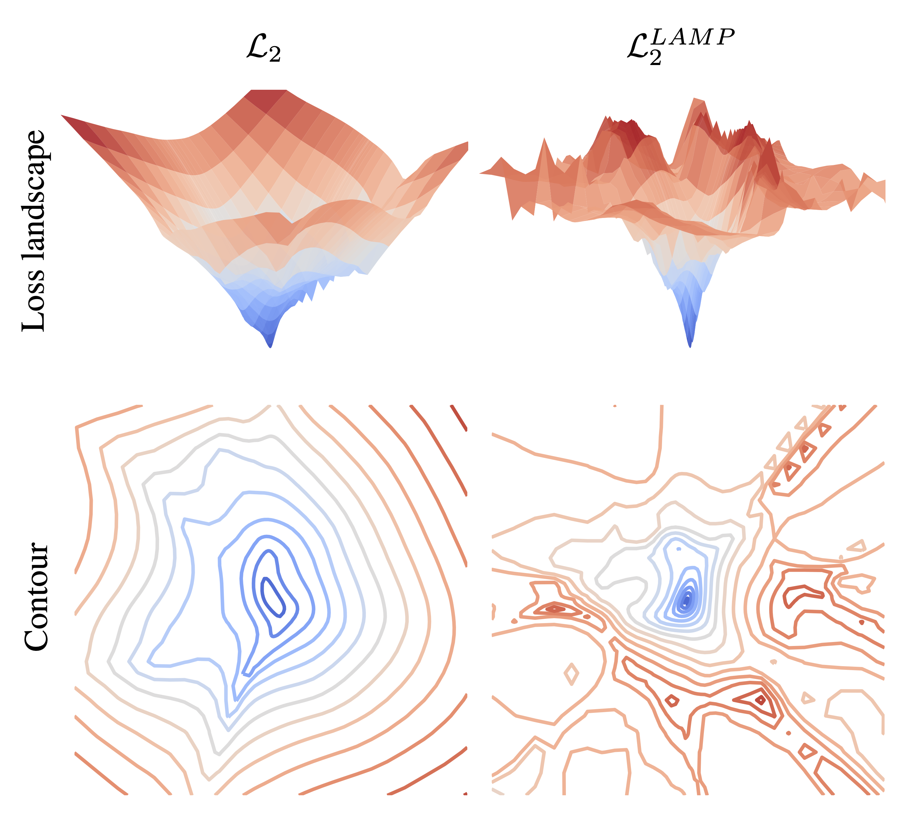

    
LAMP

Loss function transformation · ICASSP 2024
</a></li>

  <li class="card"><a href="https://ieeexplore.ieee.org/document/10065567">
    
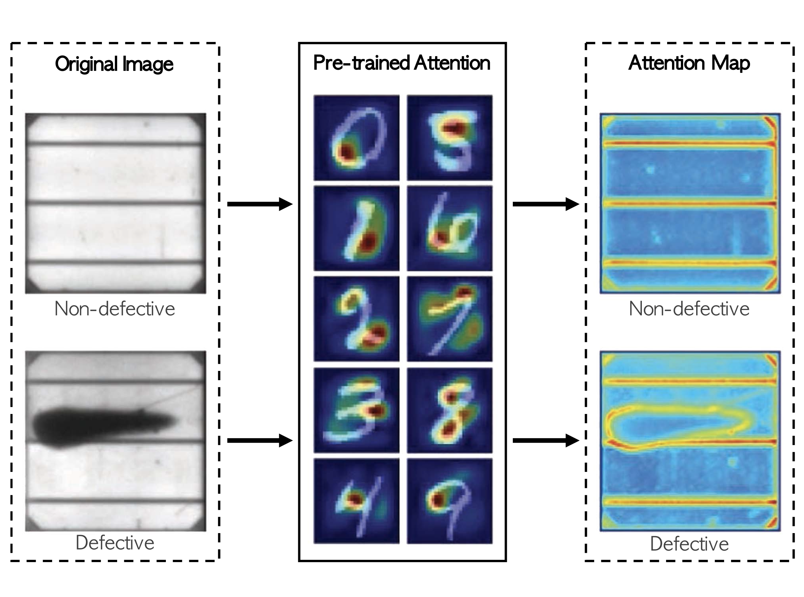

    
Defective Solar Panel Detection

Attention recycling · IEEE T-IA 2023
</a></li>

  <li class="card"><a href="https://ieeexplore.ieee.org/abstract/document/10393463">
    
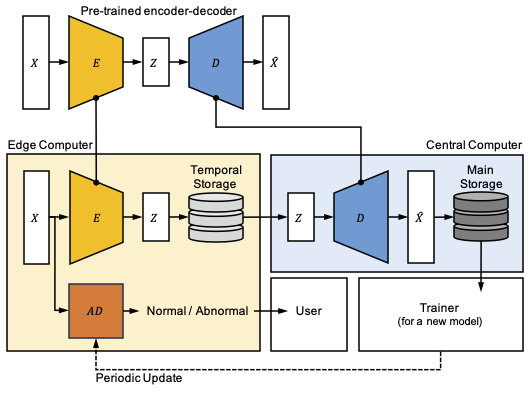

    
Edge Storage Efficiency

Zero-shot data compression · ICTC 2023
</a></li>

  <li class="card"><a href="https://onlinelibrary.wiley.com/doi/10.1002/tee.23672">
    
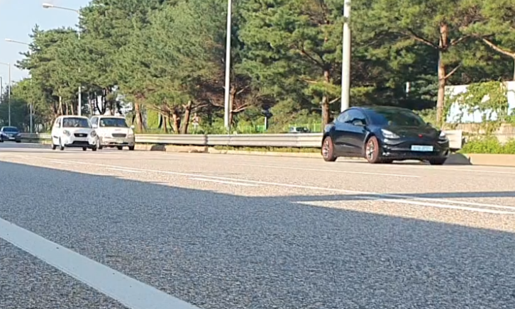

    
Road Anomaly Detection

Driving noise · IEEJ TEEE 2022
</a></li>

  <li class="card"><a href="https://ieeexplore.ieee.org/document/9645739">
    
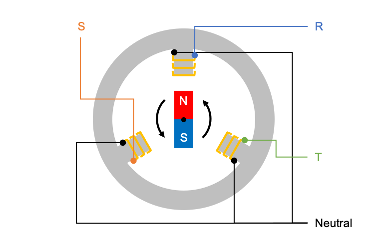

    
Electric Motor Anomaly Detection

Cost-effective auto-encoder · ECICE 2021
</a></li>

  <li class="card"><a href="https://onlinelibrary.wiley.com/doi/full/10.4218/etrij.2020-0052">
    
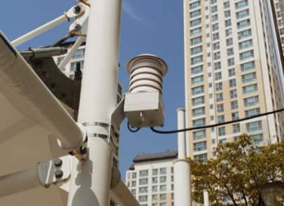

    
HP-GAN

Sensor anomaly detection · ETRI Journal 2020
</a></li>

  <li class="card"><a href="https://ieeexplore.ieee.org/abstract/document/8771175/">
    
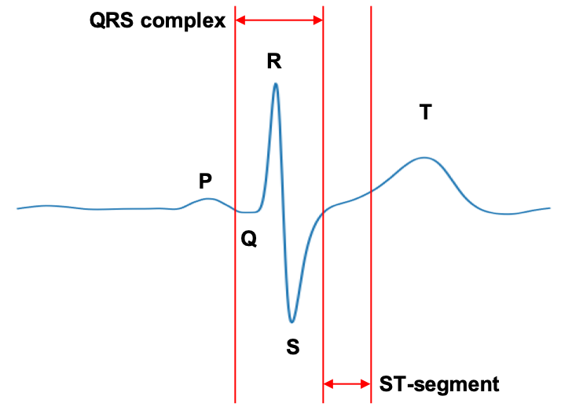

    
STEMI Detection in ECG

12-lead preprocessing · IEEE Access 2019
</a></li>

  <li class="card"><a href="https://www.mdpi.com/1424-8220/18/10/3573">
    
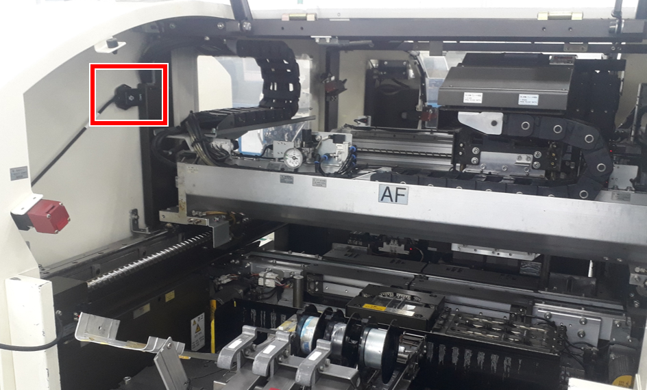

    
FARED

SMD anomaly detection · Sensors 2018
</a></li>
</ul>
